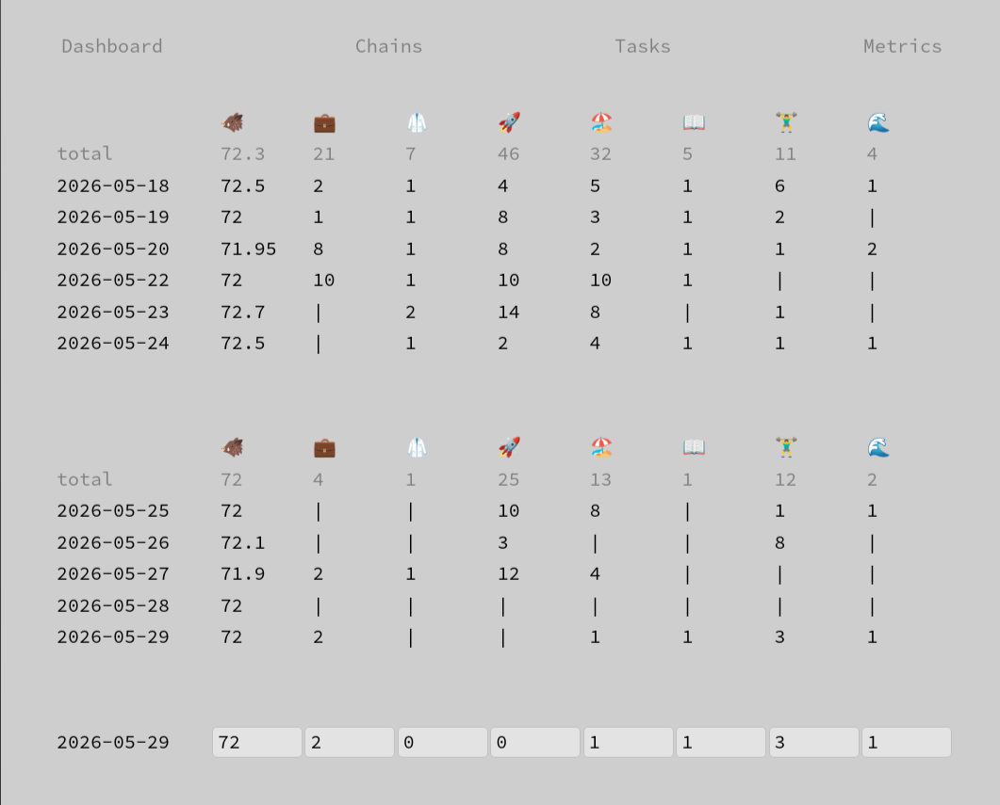

# Habits
[](https://github.com/ksevelyar/habits-vue)

## Documentation
* [Chains](doc/chains.md)
* [Charts](doc/charts.md)
* [Devices](doc/devices.md)
* [Errors](doc/errors.md)
* [Metrics](doc/metrics.md)
* [Ledger categories](doc/ledger/categories.md)
* [Ledger transactions](doc/ledger/transactions.md)
* [Nginx](doc/nginx.md)
* [Tasks](doc/calendar/tasks.md)
* [Telegram notifications](doc/calendar/telegram-notifications.md)
* [WebSocket notifications](doc/calendar/websocket-notifications.md)
* [Sessions](doc/sessions.md)
* [Users](doc/users.md)

## Run
```
nix develop
cargo sqlx database create
cargo watch -x run
```

## Build
```
cargo sqlx prepare
nix build
```
